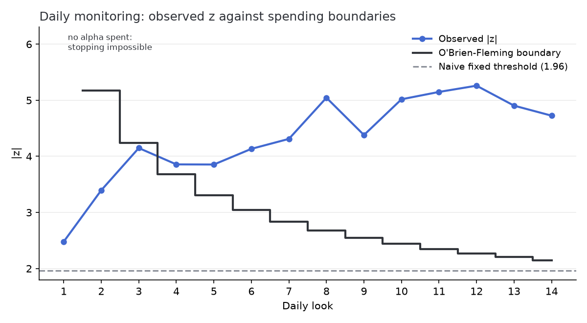

# abkit

A small A/B testing and experiment-analysis toolkit I wrote around the parts
of experimentation that actually go wrong in practice: broken assignment,
novelty effects, peeking, multiple comparisons, and revenue metrics with
tails heavy enough to break the CLT at realistic sample sizes.

Fourteen daily peeks at a fixed |z| > 1.96 turn a nominal 5% false-positive
rate into 21.9%. An O'Brien-Fleming spending design built on the same fourteen
realized information fractions holds it at 4.9%. Both figures come from
100,000 simulated null runs at a fixed seed, and `python analysis/run_analysis.py`
reproduces them.



If you only read one thing, read [analysis/report.md](analysis/report.md).
It walks a synthetic checkout-redesign experiment from power analysis to a
ship recommendation, including a revenue metric where Welch, the bootstrap,
and a permutation test return three different verdicts on the same data and
the right move is to say so rather than pick one. Because the data are
synthetic, the report closes by putting its headline conclusions next to the
effects the generator actually planted.

## What is here

- `src/abkit/generators.py` — synthetic experiment data with the failure
  modes built in as parameters: unequal allocation, sample-ratio mismatch
  from asymmetric tracking loss, a novelty effect that decays over the run,
  and zero-inflated lognormal revenue with a Pareto whale tail (infinite
  variance by default).
- `src/abkit/frequentist.py` — pooled two-proportion z-test, Welch t-test,
  chi-square SRM check, and Bonferroni / Holm / Benjamini-Hochberg adjusted
  p-values.
- `src/abkit/resampling.py` — percentile bootstrap, a permutation test, and a
  trimmed-mean difference for diagnosing whale-driven results. The bootstrap
  and permutation loops vectorize over resamples in 256-row chunks, so peak
  memory is set by the chunk size rather than the resample count. The
  permutation test assumes nothing about the outcome distribution beyond
  exchangeability under the null, which is why it is the one I lean on for
  revenue.
- `src/abkit/sequential.py` — group-sequential monitoring with O'Brien-Fleming
  and Pocock alpha spending. Boundaries come from the standard recursive
  numerical-integration construction, not a lookup table, so arbitrary look
  schedules work (the report uses the 14 realized daily information
  fractions).
- `src/abkit/power.py` — analytic power, sample size, and MDE, plus a
  simulated-power routine that the tests use to keep the formulas honest.

## How it is tested

Statistical code can be wrong and still return plausible numbers, so the suite
tests statistical properties rather than plumbing. I simulate the type I error
rate of each test at a fixed seed, and I measure confidence interval coverage
instead of assuming it.

The sequential boundaries get the most scrutiny, because they are the part I
could most easily have got subtly wrong. They are checked against a published
Lan-DeMets Pocock table for five equal looks, against exact bivariate and
trivariate normal rectangle probabilities from scipy (which share no code with
my recursion), against Monte Carlo crossing rates, and against a grid
refinement that pins the accuracy the module docstring claims. One test exists
purely to demonstrate the motivating failure and its fix: fourteen naive daily
peeks at z = 1.96 reject on 22% of null runs, while the spending boundaries on
those same simulated paths hold 5%.

The suite also covers the directions that are easy to leave untested — that a
two-sided boundary stops a treatment which *hurts*, not just one that helps,
and that a cumulative count series which goes backwards raises rather than
manufacturing a significant result.

## Running it

```bash
python -m venv .venv
.venv/Scripts/python -m pip install -e '.[dev]'  # .venv/bin/python on Unix; quotes matter in zsh
.venv/Scripts/python -m pytest
.venv/Scripts/python analysis/run_analysis.py    # regenerates the report and figures
```

Python 3.11+. The library depends only on numpy and scipy; matplotlib is a
dev dependency used by the analysis script. Rerunning the analysis reproduces
`report.md` byte for byte, though figures can shift across matplotlib
versions — CI regenerates the report on every push and fails if the committed
copy has drifted. There is no hidden global RNG state anywhere in the library:
every function that draws randomness takes an explicit
`numpy.random.Generator`.

## What it does not do

No CUPED or regression adjustment. That is the largest sensitivity win
available for this kind of analysis and the first thing I would add, but it
needs the generators to emit a pre-experiment covariate first. No futility
boundaries, so the monitoring code can stop a clear winner early but not a
hopeless run. No confidence interval for the effect after a sequential stop,
which is why the report warns that the estimate at the stopping look is biased
upward rather than correcting it. The bootstrap handles mean differences only,
so it can stay fully vectorized. Assignment is i.i.d. per user, so nothing
here demonstrates variance estimation when the randomization unit differs from
the analysis unit. Full list in [TODO.md](TODO.md).

## Decisions worth flagging

The z-test uses the pooled standard error for the statistic and the unpooled
one for the confidence interval: the pooled variance is the right one under
the null the test is evaluating, the unpooled one is right away from the null
where the interval lives.

The permutation test gives each user a random key and takes `argpartition` of
those keys to pick a treatment-sized subset. That keeps a whole chunk of
permutations inside one vectorized call, and costs O(n) per permutation where
`argsort` of the same keys would cost O(n log n). At the report's scale —
10,000 permutations over 120,000 pooled users — that is about 10 s against 28 s
for `argsort` and 22 s for a per-row Fisher-Yates shuffle, which is also O(n)
but has to materialize and permute the full block.

The bootstrap interval is percentile rather than BCa. Percentile undercovers
slightly on skewed data: the coverage test measures 90-98% against a nominal
95% on lognormal arms at n = 400. That is acceptable for mean differences at
experiment scale, and BCa is the first item in TODO.md.

Results come back as frozen dataclasses because `result.p_value` reads better
in a review than `result[3]`.

Deferred work is in [TODO.md](TODO.md). The conventions I held myself to —
full type hints, explicit generators, no swallowed errors — are in
[CLAUDE.md](CLAUDE.md).
