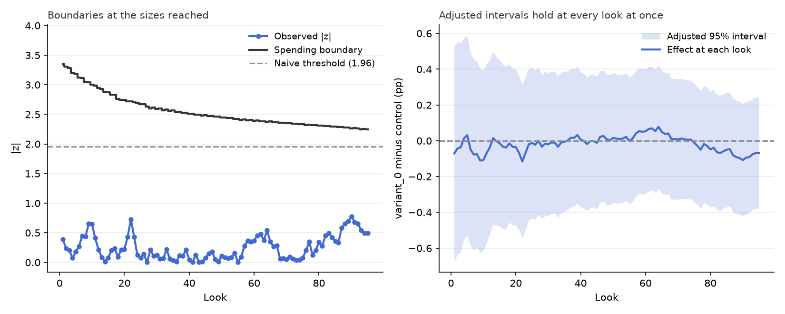

# abkit

abkit is a command-line program that reads an exported experiment file and
prints a readout. Its goal is to make the evaluation of an A/B test one
ordered pass instead of one test at a time. The readout puts the data checks
first and the result after. The standard tests come from statsmodels and
scipy. The repo's own code is the intake that checks and repairs the file,
and the order of the readout. It also replays a finished run checkpoint by
checkpoint, as if the experiment were still being watched, which those
libraries do not do. It is built for an analyst who has an exported file and
no experimentation platform, or who wants a second opinion on a dashboard.

A look is one check of an experiment's running totals. Checking at every
look against the usual cutoff, a z (the effect divided by its standard
error) past 1.96, raises the false-positive rate well above the 5% it is
meant to hold. On fourteen daily looks at a null effect, that rule rejects
21.8% of runs. An O'Brien-Fleming spending design treats the 5% as a budget
divided across the looks, spends almost none of it early and most of it at
the end, and rejects 4.9% on the same fourteen looks. Where a file has
checkpoints, the replay applies that design to the finished run. Both
figures come from 50,000 simulated null runs at seed 42, pinned by a test in
`tests/test_sequential.py`.



*The ASOS experiment quoted below, replayed look by look. The observed |z|
path stays under both the spending boundary and the naive 1.96 line at every
look, so the run would not have stopped early under either rule.*

## The readout

The readout is a text file of labeled blocks, with no generated prose. Each
heading carries a few words on how to read its block, and the file closes
with one decision line per treatment and the figures' paths. The committed
readout of a real ASOS.com experiment follows, whole. The file is
[analysis/asos/readout.txt](analysis/asos/readout.txt).

```text
ASOS experiment 54a85a: per-group totals
Data: what the intake did before any statistic
  users   control 3,320,536   variant_0 102,316   variant_1 3,316,730   variant_2 3,320,435
  repairs and drops   none; the file passed every rule as delivered

Limitations (*): read every result below with these in view
  * aggregate data carries no per-user pre-experiment values, so CUPED cannot run
  * 3 gaps in the checkpoint sequence (the largest 1 day against a typical 0.5); the time-based
      blocks treat the checkpoints present as the whole run
  * the final checkpoint is internally inconsistent and left out of the time-based blocks; the
      variance implied for the users added there comes out negative, which no real accumulation of
      users produces; the end-of-run blocks use the final totals, which stand on their own; only the
      step from the checkpoint before fails
  * the time-based blocks treat each checkpoint's new users as a group whose outcomes then stay
      fixed; a file that recomputes outcomes over all enrolled users at each checkpoint makes those
      blocks approximate; the inconsistent final checkpoint is one sign of that here
  * the replay has 95 looks; the boundary calculation is checked for accuracy on 14 looks, so treat
      its boundaries as approximate

Group split: does assignment match the plan?
  intended split not on record; testing whether the share of new users per checkpoint is constant
  chosen   first treatment in the arm order, not by its result
  variant_0 vs control   96 checkpoints   chi-square 78.23   df 95   p 0.894
  result   stable across checkpoints

Sensitivity: smallest lift this sample could detect, 80% power
  each at alpha 0.05/3, the strictest level the Holm correction applies
  variant_0 vs control   102,316 vs 3,320,536 users   control 25.1%   detectable 0.45 pp (1.8% of
      control)
  variant_1 vs control   3,316,730 vs 3,320,536 users   control 25.1%   detectable 0.11 pp (0.4% of
      control)
  variant_2 vs control   3,320,435 vs 3,320,536 users   control 25.1%   detectable 0.11 pp (0.4% of
      control)

Primary metric_1: effect, 95% interval, p; interval first
  variant_0 vs control   -0.07 pp   -0.33 to +0.20 pp   p 0.635   Holm 0.635   not detected
  variant_1 vs control   +0.10 pp   +0.04 to +0.17 pp   p 0.003   Holm 0.008   detected, treatment
      higher
  variant_2 vs control   -0.06 pp   -0.12 to +0.01 pp   p 0.085   Holm 0.170   not detected
  Holm-corrected across the 3 treatments; detection judged on the Holm p; intervals unadjusted

Other metrics: corrected for 9 comparisons (Holm, and BH = Benjamini-Hochberg)
  metric_2   variant_0 vs control   +0.001   p 0.893   Holm 1.000   BH 0.893
  metric_2   variant_1 vs control   +0.002   p 0.106   Holm 0.703   BH 0.238
  metric_2   variant_2 vs control   -0.002   p 0.100   Holm 0.703   BH 0.238
  metric_3   variant_0 vs control   -0.003   p 0.848   Holm 1.000   BH 0.893
  metric_3   variant_1 vs control   +0.009   p 0.033   Holm 0.296   BH 0.238
  metric_3   variant_2 vs control   -0.007   p 0.088   Holm 0.703   BH 0.238
  metric_4   variant_0 vs control   -0.185   p 0.628   Holm 1.000   BH 0.808
  metric_4   variant_1 vs control   +0.065   p 0.497   Holm 1.000   BH 0.745
  metric_4   variant_2 vs control   -0.110   p 0.251   Holm 1.000   BH 0.451
  result   unadjusted 1 of 9 below 0.05; after Holm 0 survive

Early versus late: did the effect fade?
  first 31 checkpoints against the last 31, of 95 usable
  variant_0 vs control   early -0.01 pp   late -1.26 pp   z 2.88   p 0.004   effect fell over the
      run
    users   early 69,687 vs 2,275,261   late 14,188 vs 450,624
  variant_1 vs control   early +0.09 pp   late +0.08 pp   z 0.09   p 0.924   no change detected
    users   early 2,275,224 vs 2,275,261   late 449,029 vs 450,624
  variant_2 vs control   early -0.17 pp   late +0.23 pp   z -3.70   p 0.0002   effect rose over the
      run
    users   early 2,274,963 vs 2,275,261   late 449,234 vs 450,624

Monitoring replay: 95 looks; 5% budget spread across them; a crossing = a stop allowed at that look
  variant_0 vs control on metric_1, O'Brien-Fleming spending at the sizes reached
  chosen   first treatment in the arm order, not by its result
  spending design   never crosses in 95 looks; no early stop in either direction
  naive 1.96 rule   never fires
  final look   effect -0.07 pp   adjusted 95% -0.38 to +0.24 pp   boundary |z| 2.25

Decision for variant_0 vs control: no detectable effect; that contrast could have seen 0.45 pp or
    more
Decision for variant_1 vs control: higher on metric_1 by +0.10 pp (+0.04 to +0.17 pp)
Decision for variant_2 vs control: no detectable effect; that contrast could have seen 0.11 pp or
    more
Figures:
  figures/corrections.png
  figures/early_late.png
  figures/monitoring.png
```

How to read it, block by block:

- **Data.** What the intake repaired or dropped, with counts.
- **Limitations.** What the checks flagged. A flag does not stop the run;
  every result below is read with these in view.
- **Group split.** Whether users landed in the groups as planned. A broken
  split means users went missing or were assigned unevenly, and no statistic
  repairs that, so the decision lines are replaced by one stop line. When
  the plan is not on record, as here, the check tests whether the share of
  new users per checkpoint stayed constant.
- **Sensitivity.** The smallest lift this sample could have detected with
  80% power. A "not detected" result means an effect at least that large
  would have been seen with 80% probability and says nothing about smaller
  ones. With several treatments it is solved at alpha divided by their
  number, so it holds under the Holm correction below.
- **Primary metric.** The effect, its 95% interval, and p for each
  treatment, interval first.
- **CUPED** (user rows with a pre-experiment column only). That metric's
  effect after removing the part of each user's outcome their pre-experiment
  value already predicted. It runs on each metric with a pre-experiment
  column, which in both committed user-row readouts is spend, not the
  primary. "Noise removed" is the share by which the adjustment shrank the
  estimate's variance, so more removed means a narrower interval.
- **Other metrics.** The secondary metrics, corrected two ways. Holm caps
  the chance of any false positive among them, which a ship decision needs.
  Benjamini-Hochberg caps the share of false positives, which is enough for
  a screen of what to test next.
- **Cross-check** (user rows with a continuous metric only). Welch's t-test,
  scipy's BCa bootstrap, which corrects the interval for skew, and a
  permutation test on the same contrast. Agreement means the result does not
  depend on the method. The trimmed mean on the last line is a different
  quantity, printed to show what the largest values are doing.
- **Early versus late.** Whether the lift seen early in the run held to the
  end. A novelty effect, a lift that fades as the feature stops being new,
  does not hold. The treatment's lift over the first third of the usable
  checkpoints is tested against its lift over the last third, with each
  window's users on the line beneath, since a small window gives a wide
  estimate. In ASOS the late window holds 14,188 of variant_0's 102,316
  users, so its -1.26 percentage points (pp) contributes about 0.18 pp to
  the whole run's -0.07 pp. The ASOS totals also appear to be recomputed
  over all enrolled users at each checkpoint, which the limitations block
  flags, so a window's lift there mixes users maturing with the effect
  changing. The readout reports the change and does not settle which it is.
- **Monitoring replay.** The finished run checked look by look against the
  spending boundary. A crossing means a stop at that look would have kept
  the false-positive rate, and nothing more: the estimate at an early stop
  runs high, and whether the effect lasted is the early-versus-late block's
  question. "Never crosses" means no look allowed a stop. On a run that
  ended on schedule, the primary block's interval is the result, and the
  adjusted interval is what a stop at any look would have had to report. The
  naive 1.96 line is printed for contrast.
- **Planted versus found** (the synthetic check only). What the generator
  planted beside what the readout found.
- **Decision.** One line per treatment, judged on the primary metric's p,
  Holm-corrected when there are several treatments. A "no detectable effect"
  line carries the sensitivity figure, so it says what was ruled out.

With several treatments, the split test across checkpoints, the cross-check,
and the replay run on the first treatment in the arm order. That rule does
not look at the results, so the choice cannot favor whichever treatment
looks best.

## What the intake does to a file

The intake never cleans a file silently. A fault it cannot repair stops the
run.

Repaired and counted:

- stray spaces trimmed, and group labels matched regardless of capitals
- value replacements the config declares applied

A byte-order mark at the start of a CSV, which Excel writes, is accepted
without a count.

Dropped and counted, with a stop above 1% of rows:

- a row whose metric value is blank, not a number, or infinite, and the same
  for a pre-experiment column or the day column
- a row whose group label is blank
- a negative value where the config says the metric cannot be negative
- a value other than 0 or 1 in a yes/no metric

A file past that share is not clean enough to read, and a readout of the
remaining rows would describe a different experiment. Some exports leave a
metric blank for users who never did the thing it counts, such as spend for
a user who bought nothing. Fill those blanks with zero before running the
tool, or the drops will pass 1% and stop the run. A blank day or
pre-experiment cell drops its row the same way.

Stops the run, naming what failed:

- a required column missing, or a group label the config does not list
- a user appearing twice, when the config names a user id column
- cumulative totals going backwards, a count of zero or less, or a negative
  variance
- a per-group file whose rows disagree with each other: a non-integer count,
  a non-finite mean or variance, control totals that differ across variants,
  or checkpoints that differ across arms
- a data file that does not match the md5 the config pins

Flagged in the limitations block:

- group sizes off from the intended split
- a metric whose top 1% of users carry more than a quarter of its total
- fewer than 10 successes or failures in an arm
- a smallest detectable effect above a 5% relative lift
- no pre-experiment column
- gaps in the checkpoint sequence
- a final checkpoint whose totals are internally inconsistent
- per-group totals over time, where the time-based blocks are approximate if
  the file recomputes earlier users' outcomes at each checkpoint
- a replay with more looks than the 14 its boundary accuracy is checked on

## Running it

```bash
python -m venv .venv
.venv/Scripts/python -m pip install -r requirements.txt  # .venv/bin/python on Unix
.venv/Scripts/python -m pytest
.venv/Scripts/python scripts/run_analyze_experiment.py --config analysis/asos/config.toml
.venv/Scripts/python scripts/run_plan_experiment.py --baseline-rate 0.05 --minimum-lift 0.005
.venv/Scripts/python scripts/run_synthetic_check.py
.venv/Scripts/python scripts/run_fetch_hillstrom.py   # fetches the 2008 dataset (not redistributed)
.venv/Scripts/python scripts/run_analyze_experiment.py --config analysis/hillstrom/config.toml
```

The analyze command prints the readout and saves it as `readout.txt` beside
the config, with the figures in a `figures/` folder. The `--out` flag
chooses another directory and `--seed` fixes the resampling seed. The
planning command prints the users needed per group for a baseline rate and
the smallest lift worth detecting, or for a standard deviation and the
smallest difference, at the chosen alpha and power.

To read your own experiment, write a config and point the analyze command at
your file:

```bash
.venv/Scripts/python scripts/run_analyze_experiment.py --config my_experiment.toml --data my_data.csv
```

Two input shapes are read. User rows hold one row per user. Per-group totals
hold one row per variant, metric, and checkpoint, with the control's count,
mean, and variance beside the variant's, which is the layout the ASOS
dataset uses. Two of the three committed configs are complete working
examples of the two shapes, `analysis/hillstrom/config.toml` for user rows
and `analysis/asos/config.toml` for per-group totals. Two conventions are
not in the table below. The first label in `arms.labels` is the control, and
ordering them the other way flips the sign of every effect. Columns the
config does not name are ignored. These are the keys a config can carry.

| Table and key | Needed | What it does |
|---|---|---|
| `[experiment]` `name` | yes | the readout's title |
| `[experiment]` `alpha` | no, 0.05 | the false-positive rate for the effect tests, the sensitivity, the corrections, and the replay, whose adjusted interval follows it; the other intervals stay 95% and the split check uses 0.001 |
| `[input]` `shape` | yes | `user_rows` or `aggregates` |
| `[input]` `path` | no | the data file, relative to the config; `--data` overrides it |
| `[input]` `md5` | no | the data file's checksum, so a readout cannot quietly describe the wrong file; a different file stops the run |
| `[columns]` `arm` | user rows | the column holding each user's group |
| `[columns]` `day` | no | the day each user entered the experiment, as a number counted from its start; dates are not parsed; turns on the early-versus-late block and the replay, which per-group totals always have |
| `[columns]` `user_id` | no | turns on the stop for a user appearing twice |
| `[columns.aliases.<column>]` | no | value replacements for the group column or any extra categorical column, old = new; metric values are read as numbers and not aliased |
| `[arms]` `labels` | user rows | the group labels, control first |
| `[arms]` `intended_split` | no | the planned share per group; turns on the check against the plan |
| `[aggregates]` `experiment_id_column`, `experiment_id` | no | keep only one experiment's rows in a file that holds several |
| `[aggregates]` column names | aggregates | where the variant, metric, checkpoint, and each group's count, mean, and variance live |
| `[[metrics]]` `name`, `kind` | yes | one entry per metric; `kind` is `binary` or `continuous` |
| `[[metrics]]` `primary` | one metric | the metric the decisions are made on |
| `[[metrics]]` `column` | no, the name | the metric's column in the file |
| `[[metrics]]` `nonnegative` | no, user rows only | drops a row with a negative value |
| `[[metrics]]` `pre_column` | no, user rows only | a value measured before assignment; turns on CUPED for that metric |
| `[truth]` | no | the synthetic check's generation settings; prints the planted-versus-found block |

The tool needs Python 3.11 or newer. There is no install step, because the
entry scripts put `src/` on the import path themselves, so a fresh clone
runs once the dependencies in `requirements.txt` are present. The library
depends on numpy, scipy, and statsmodels, and the figures need matplotlib,
which that file pins with the dev tools. Rerunning a readout with the
versions pinned there reproduces `readout.txt` byte for byte. CI regenerates
the ASOS and synthetic readouts on every push to master, with the newest
versions `pyproject.toml` allows, and fails if a committed copy has drifted.
The Hillstrom readout is outside that check, since its data is fetched
rather than committed and CI should not depend on a 2008 URL staying up.

## The three committed readouts

[analysis/asos/readout.txt](analysis/asos/readout.txt), quoted above, reads
one experiment from the ASOS Digital Experiments Dataset, published as
cumulative per-group totals at 96 checkpoints with no user rows. Three
treatments ran against the control, and the dataset's authors flagged this
experiment for a possible primacy effect, an effect that grows over the run
as users adjust, which is why it was chosen. The early-versus-late block
shows one treatment rising over the run, which is that shape, under the
caveat the limitations block states about recomputed totals. The final
checkpoint is internally inconsistent, so the time-based blocks leave it out
and the limitations block says so.

[analysis/hillstrom/readout.txt](analysis/hillstrom/readout.txt) reads the
2008 MineThatData e-mail experiment, user rows with three arms. Fewer than
1% of its users spent anything, which the limitations block flags, and a
misspelled zip-code category is normalized and counted by the intake. Both
e-mail arms raise visits, and the cross-check's three methods agree on the
spend effect. CUPED on the past-spending column removes none of the noise,
which is what a pre-experiment value that does not predict the outcome
produces.

[analysis/synthetic/readout.txt](analysis/synthetic/readout.txt) is not an
example of analysis. It is a test of the tool. One generated experiment with
planted effects runs through the same intake and readout as the real files,
and the readout is checked against what was planted. The planted conversion
lift is found where it was planted. The expected lift at the end of the run
is +0.67 pp, and the readout finds +0.67 pp with an interval of +0.39 to
+0.95 pp. The planted fade in that lift shows in the early-versus-late
block. The planted rise in spend, +0.32 per user, is too small for this
sample to detect under its heavy tail, a few users spending far more than
the rest, which the planted block's whale settings produce. The readout
reports it as not detected, with an interval that contains the planted
value, rather than as found. CUPED removes 14% of the noise on spend at this
seed, and 12% to 18% across the seeds in the notes. The settings are in the
config beside the readout, and its last block prints each one beside what
was found.

## What it does not do

It assumes users were randomized one by one. An experiment that randomized
groups of users, such as stores or communities, needs a variance estimate
this tool does not have, and nothing in the file lets it detect that. It
draws no causal conclusion beyond the randomized comparison. The replay
reads a finished file and cannot watch a running experiment, because each
boundary depends on the final look's sample size. There are no futility
boundaries, so the replay can show an early stop on a clear effect but never
on a hopeless run. On user rows each look holds the users enrolled by then
with their final outcomes, so a live look would have known less than the
replay shows. After a sequential stop the only interval is the adjusted one.
Every metric is one value per user, and the bootstrap covers a difference in
means only, so a ratio such as revenue per order, whose denominator varies
by user, is out of scope. The relative lift is a point estimate without an
interval. The bootstrap interval is scipy's BCa, which on skewed data runs a
little under its nominal 95% coverage. The measurement is in the notes.

## For the technical reader

Statistical code can be wrong and still return plausible numbers, so the
suite tests statistical properties. The false-positive rates of the z-test,
the permutation test, and the spending boundaries are simulated at fixed
seeds, interval coverage is measured rather than assumed, and the proportion
power function is pinned against an exact binomial calculation. The boundary
calculation, run with Lan and DeMets's Pocock-type spending, is checked
against published values. The boundaries are also checked against exact
bivariate and trivariate normal rectangle probabilities from scipy, against
Monte Carlo crossing rates, and against a grid refinement. The adjusted
intervals are checked for joint coverage over 20,000 simulated null paths.
The intake has one test per rule on injected bad data and one per limitation
code on data built to raise it. The readout text is pinned to two saved
copies of the expected text that are read by eye when they change.

Spotify's confidence library covers the same ground, takes summary
statistics as input, and includes sequential tests. Run on the same ASOS
experiment as a cross-check, it gave the primary metric's z-test p-value as
0.6345 against this repo's 0.635, and identical Holm-adjusted p-values on
the other three metrics. Its sequential test over the 95 looks flagged no
stop, and its final adjusted interval was -0.38 to +0.25 pp against this
repo's -0.38 to +0.24 pp. The source of that last gap has not been traced.
The library takes the planned final sample size as an input and so can run
on a live experiment, which this tool cannot. It was not taken as a
dependency because it installed 68 packages, pins pandas below 3, and is
marked beta, and because the intake and the ordering are the part this repo
is meant to own.

Two decisions are worth flagging. The permutation test calls scipy rather
than the faster hand-built loop it replaced. Speed is not a concern at the
sizes experiments run at, a scipy call is one less thing to defend, and the
timing is in the notes. The monitoring boundaries are computed at the sample
sizes the looks actually reached rather than on a planned schedule, with the
information at each look measured by user counts rather than by the observed
variances. The method is the recursive numerical integration of Armitage,
McPherson, and Rowe, which carries forward the probability that no earlier
look has crossed and solves each look's cutoff from it. The adjusted
intervals are each look's estimate plus or minus that look's boundary times
its standard error.

The dated measurements behind this section, the timings, and the history of
the synthetic generator are in [docs/NOTES.md](docs/NOTES.md).

## Repo layout

- `src/abkit/io.py`: the config, the two loaders, and the checks and
  repairs.
- `src/abkit/readout_analysis.py`: every number the readout reports,
  computed once, no text.
- `src/abkit/readout_text.py` and `readout_figures.py`: the lines and the
  figures.
- `src/abkit/frequentist.py`, `power.py`, `resampling.py`, and
  `cuped_adjustment.py`: thin wrappers over statsmodels and scipy. The tests
  among them return the repo's result dataclasses.
- `src/abkit/sequential.py`: the spending boundaries and the adjusted
  intervals.
- `src/abkit/results.py`: the frozen result dataclasses the statistical
  functions return.
- `src/abkit/generators.py`: the generated experiment the synthetic pipeline
  check runs on.
- `scripts/`: the analyze, plan, synthetic, and fetch commands.
- `analysis/`: the three committed readouts with their configs and figures.
- `data/asos/`: the one committed dataset, the ASOS Digital Experiments
  Dataset (CC BY 4.0), with its license notice beside it.
- `tests/`: the suite, mostly one file per module.
- `docs/NOTES.md`: dated measurements and decisions.

## Conventions

Every public function carries full type hints, and every statistical test
returns a frozen dataclass rather than a tuple. Randomness always flows
through an explicit `numpy.random.Generator` parameter, with no module-level
seeding. Inputs fail with an explicit `ValueError`. Two exceptions exist.
The intake's coercion catch turns an unreadable value into a counted and
reported row drop, and the two time-based blocks omit themselves on a data
error after printing it in full. Tests are two-sided unless the function
name says otherwise, p-value adjustments take and return arrays in the
original order, and anything approximate states its accuracy in its
docstring and has a test pinning it against a published or simulated value.
Spelling is US throughout.
