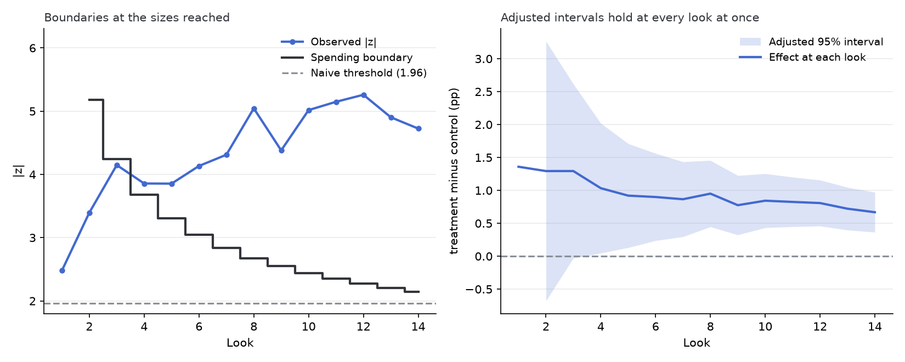

# abkit

abkit is a command-line program that reads an exported A/B test file and
prints a readout, a text report of the data checks and the test results. Its
goal is to make the evaluation of an A/B test one ordered pass instead of
one test at a time. The readout puts the data checks first and the result
after. The standard tests come from statsmodels and scipy. The project intake
checks and repairs the file before any test runs.

The readout also monitors a run that is still going. It judges each look
against the size the run was planned to reach and says whether a stop is
allowed yet. A planning command gives that size before the test starts.
Neither statsmodels nor scipy offers that monitoring. It is built for an
analyst who has an exported file and no experimentation platform, or who
wants a second opinion on a dashboard.

This document covers setup, using the tool on your own experiment, the
argument reference, how the readout and its monitoring block are read, and
what the intake does with a file. The two runs committed in the repo follow,
a demonstration on the Hillstrom e-mail experiment and a synthetic check
with planted effects. The limitations close the document.

## Setup and run

Requires git and Python 3.11 or later.

In a terminal, run the following commands.

1. Clone the repository:

   ```
   git clone https://github.com/RAStevenson/ab-testing-framework.git
   ```

2. Navigate to the root directory:

   ```
   cd ab-testing-framework
   ```

3. Create a new environment and activate it (on Mac or Linux the second
   line is `source .venv/bin/activate`):

   ```
   python -m venv .venv
   .venv\Scripts\activate
   ```

4. Install dependencies:

   ```
   pip install -r requirements.txt
   ```

abkit itself is not installed. The entry scripts put `src/` on the import
path, so a fresh clone runs once the dependencies are installed. The
versions in `requirements.txt` are the ones the committed readouts were
produced with, and rerunning a readout with them reproduces `readout.txt`
byte for byte.

### Using it on your own data

The tool sizes a test before the start, monitors it while it runs, and reads
the exported file when it is done. The last two take a config, a TOML file
whose keys the table at the end of this section lists. Every argument is
listed under [Script arguments](#script-arguments).

To size the test, give the planning command the expected baseline rate and
the smallest lift worth acting on, as fractions, or for a continuous metric
such as spend, the metric's standard deviation and the smallest difference
in means:

```
python scripts/run_plan_experiment.py --baseline-rate 0.05 --minimum-lift 0.005
python scripts/run_plan_experiment.py --standard-deviation 12 --minimum-difference 0.5
```

Both the baseline rate and the standard deviation come from past data, such
as last month's users or an earlier test's control group. The standard
deviation is taken over the same per-user value the test will compare, such
as each user's spend over two weeks. Once the test has run, the readout's
sensitivity block recomputes what the test could detect from the spread the
data actually shows.

With no past data, one way to plan is to make a yes/no version of the metric
the primary one, such as whether a user bought anything. A yes/no metric's
spread follows from its rate, so only the rate has to be guessed. Otherwise
the standard deviation has to be guessed.

Either command prints the users required per group, at 80% power and alpha
0.05 unless told otherwise. Put that number in the config as
`planned_users_per_group` before the first look. A run that will be checked
daily can raise it by a few percent, for the reason given under "Monitoring
a run".

To monitor the run, export the rows so far with a day column and run the
analyze command on each new export:

```
python scripts/run_analyze_experiment.py --config my_experiment.toml --data my_data.csv
```

The file is a comma-separated CSV in UTF-8 with a header row. The monitoring
block says whether a stop is allowed yet, and the decision line follows it.

To read a finished run, run the same command on the final export. With no
day column, the readout is the data checks and the results, with no
monitoring block. The Hillstrom config, `analysis/hillstrom/config.toml`, is
a complete working example. Data columns the config does not name are
ignored.

A config is a plain text file saved with a `.toml` ending. Part of it names
columns of the CSV. The rest states what the CSV cannot: which group is the
control, which outcome the decision rests on, and how the users were meant
to be split. For a file with one row per user and these columns,

#### Example data (.csv file)

```
variant,converted,spend
control,0,0
control,1,12.50
new_page,1,49.99
new_page,0,0
```

#### Example config (.toml file)

```toml
[experiment]
name = "Checkout page test"

[columns]
group = "variant"

# the first label is the control group
[groups]
labels = ["control", "new_page"]
intended_split = [0.5, 0.5]

# one [[metrics]] block per outcome column
[[metrics]]
name = "converted"
kind = "binary"
primary = true

[[metrics]]
name = "spend"
kind = "continuous"
nonnegative = true
```

`[columns]` names the column that holds each user's group, and `[groups]`
lists the values found in it, control first. Each `[[metrics]]` block names
one outcome column and says whether it holds yes/no values or amounts. The
table lists every key a config uses.

| Table and key | Required | Description |
|---|---|---|
| `[experiment]` `name` | yes | the readout's title |
| `[experiment]` `alpha` | no, default = 0.05 | the false-positive rate for the tests, the corrections, the sensitivity, and the monitoring with its adjusted interval; the other intervals stay 95% and the split check uses 0.001 |
| `[experiment]` `planned_users_per_group` | no | the size each group is planned to reach, the number the planning command prints; with a day column, the monitoring block judges each look against it |
| `[input]` `path` | no | the data file, relative to the config; `--data` overrides it |
| `[input]` `md5` | no | the data file's checksum, so a readout cannot be made from the wrong file; a different file stops the run |
| `[columns]` `group` | yes | the column holding each user's group |
| `[columns]` `day` | no | the day each user entered the experiment, as a whole number such as days since the start, not a date; each distinct value is one look, so a timestamp in seconds would make nearly every user its own look; three or more distinct days turn on the monitoring block |
| `[columns]` `user_id` | no | turns on the stop for a user appearing twice |
| `[columns.aliases.<column>]` | no | value replacements for a text column, old = new, counted as repairs; an alias table on a metric, pre-experiment, day, or user id column stops the run |
| `[groups]` `labels` | yes | the group labels, control first; reversing them flips the sign of every effect |
| `[groups]` `intended_split` | no | the planned share per group; turns on the check against the plan |
| `[[metrics]]` `name`, `kind` | yes | one entry per metric; `kind` is `binary` or `continuous` |
| `[[metrics]]` `primary` | yes, one metric required | the metric the decisions are made on |
| `[[metrics]]` `column` | no, default = name | the metric's column in the file |
| `[[metrics]]` `nonnegative` | no | drops a row with a negative value; leave it off where negatives are real, such as revenue net of refunds |
| `[[metrics]]` `pre_column` | no | a column measured before assignment; turns on CUPED for that metric, and a row with no number there is dropped |
| `[truth]` | no | the synthetic check's generation settings; prints the planted-versus-found block and labels the closing lines and the monitoring figure as synthetic |

## Script arguments

This lists every argument of every user-facing script, mirroring `--help`,
which each script prints with `-h`.

### `run_fetch_hillstrom.py`

Takes no arguments. It downloads the Hillstrom file from its original URL
into `data/hillstrom/`, checks the download against the SHA-256 pinned in
the script, and refuses a file that does not match, keeping the rejected
bytes beside the cache for review. A cached file that matches is not
downloaded again.

### `run_analyze_experiment.py`

Required:

- `--config`: the experiment TOML, with the keys listed under "Using it on
  your own data". The Hillstrom config is a complete example.

Optional:

- `--data`: the data file to read, overriding the config's `[input]`
  `path`. The config's `md5`, when set, is still checked against this file.
- `--out`: the directory for `readout.txt` and the `figures/` folder.
  Default is the config's directory.

### `run_synthetic_check.py`

Optional:

- `--config`: the recipe TOML, an experiment config with a `[truth]` table
  of generation settings. Default `analysis/synthetic/config.toml`.
- `--out`: the directory for the readout and figures. Default is the
  config's directory. The generated rows go to the config's `[input]`
  `path`, which for the default recipe is `data/synthetic/`, ignored by
  git.

### `run_plan_experiment.py`

Required, one pair or the other:

- `--baseline-rate` with `--minimum-lift`: for a yes/no metric, the baseline
  rate and the smallest absolute lift worth detecting, as fractions such as
  0.05 and 0.005.
- `--standard-deviation` with `--minimum-difference`: for a continuous
  metric, its standard deviation per user, from past data, and the smallest
  difference in means worth detecting, in the metric's own units.

Passing both pairs, or neither, stops the command with an error naming the
choice.

Optional:

- `--alpha`: the false-positive rate. Default 0.05.
- `--power`: the chance of detecting an effect of the stated size. Default
  0.8.

## How it works

A run has three stages. The intake, in `src/abkit/experiment_intake.py`,
reads the config and the CSV, repairs and drops what its rules allow with a
count of each, and stops on a fault it cannot count. The analysis, in
`src/abkit/readout_analysis.py`, computes every number the readout reports.
The writers, `src/abkit/readout_text.py` and `src/abkit/readout_figures.py`,
print the lines and draw the figures. The three stages run inside one
function, in `src/abkit/experiment_readout.py`. Every run goes through it,
including the Hillstrom demonstration and the synthetic check. The
significance tests, the power calculation, and CUPED are thin wrappers over
statsmodels and scipy, in the modules `significance_tests.py`,
`power_analysis.py`, and `cuped_adjustment.py`. The monitoring block's
spending boundaries and adjusted intervals are the project's own, in
`src/abkit/group_sequential.py`.

## The readout

The readout is a text file of labeled blocks rather than paragraphs. Each
heading carries a few words on how to read its block, and the file closes
with one decision line per treatment and the figures' paths. The blocks come
in this order:

- **Data.** Each group's user count and its share of the total, then what
  the intake repaired or dropped, with counts.
- **Limitations.** What the checks flagged. A flag does not stop the run.
  Flags come from the data, never from an effect the readout found, so a
  flag can sit beside a result it does not affect.
- **Group split.** A sample ratio mismatch (SRM) check of the group sizes
  against the intended split. A chi-square p below 0.001 counts as broken.
  No statistic repairs a broken split, so one stop line then replaces the
  decision lines.
- **Sensitivity.** The minimum detectable effect (MDE), the smallest lift on
  the primary metric this sample could detect with 80% power. With several
  treatments it is computed at alpha divided by their number, the strictest
  level the Holm correction applies, so an effect that large has an 80%
  chance of detection however the other comparisons come out.
- **Primary metric.** The effect, its 95% interval, and p for each
  treatment, from a two-proportion z-test on a yes/no metric or Welch's
  t-test on a continuous one. Lifts on a yes/no metric are in percentage
  points (pp). With several treatments, the readout also prints a
  Holm-corrected p, which caps the chance of any false positive among the
  comparisons at alpha. An effect counts as detected when that corrected p
  is below alpha.
- **CUPED** (controlled-experiment using pre-experiment data). A metric's
  effect with less noise, after a regression removes what each user's
  pre-experiment value already predicted. It runs on each metric that has a
  pre-experiment column. Its p is not corrected for the other comparisons.
- **Other metrics.** The secondary metrics, corrected two ways. Holm, as on
  the primary metric, suits a ship decision. Benjamini-Hochberg caps the
  expected share of false positives among the results it flags, which is
  enough for a screen of what to test next. Neither correction counts the
  primary metric's comparisons, so adding a secondary metric never makes the
  correction on the primary metric stricter.
- **Decision.** One line per treatment, judged on the primary metric. A "no
  detectable effect" line carries the sensitivity figure, so it says what
  size of effect the run could have seen.

The demonstration on the Hillstrom e-mail experiment, later in this
document, shows a complete readout.

## Monitoring a run

An A/B test is usually watched while it runs, and the first day the result
looks significant brings pressure to stop. Every look at the running result
is another chance of a false positive, an effect detected when none is
there. One check at the usual cutoff carries a 5% chance of a false
positive. Checking every day for two weeks and stopping on the first
significant day raises that chance well above 5%. A spending design holds
that chance at 5% for the whole run by treating the 5% as a budget spread
across the looks. Each day then gets a stricter cutoff than a single check
would.

The monitoring block applies that design look by look, against the size the
run was planned to reach. On a file short of the plan it says whether a stop
is allowed yet. A run still going and a run someone stopped early, on a day
the dashboard looked significant, look the same in the file. For an early
stop, that answer says whether the stop was allowed.

A file whose day column holds at least three distinct days gets the block,
printed after the other results. When the data cannot support a test on one
of those days, such as a first day with no conversions in either group, the
readout leaves the block out and the console prints the error.

A look is one check of the primary metric's running totals, one per day in
the file. Each look is scored as z, the effect divided by its standard
error. The single-check cutoff is z past 1.96 in either direction, the same
as p below 0.05. The spending design gives each look its own cutoff, called
the spending boundary. The design used here is Lan-DeMets alpha spending,
developed for clinical trials. Its O'Brien-Fleming-style function spends
almost none of the budget early and most of it at the end.

The plan comes from the config key `planned_users_per_group`, set to the
number the planning command prints. Each look's share of the plan sets how
much of the budget it may spend, so a boundary depends only on the looks
before it and the plan, never on looks still to come. The first look to
reach the plan is the final look, and looks after it are not judged, because
the design has spent its whole budget by then. A limitation flag says how
many looks the run continued past it. Without the key, the block takes the
last look in the file as the plan and says so. Read that way, it judges a
run stopped early by peeking as if the early stop had been the plan, so the
key is what gives the block its meaning.

The planning command sizes a test for a single check at the planned size.
Looking daily costs a little power, because the final look's boundary sits
above 1.96. A run that will be monitored can raise the plan by a few percent
to keep its power. The measured cost for fourteen daily looks is in
`docs/NOTES.md`.

The block prints the look where z first crosses the spending boundary, if it
does, and the latest look's effect with its adjusted interval, an interval
widened to allow for the repeated looks. A crossing means the design allows
a stop at that look. For a run checked at exactly these looks, stopping at
the first crossing holds the false-positive rate at 5%. A crossing says
nothing about the effect's size. "Never crosses" means no look allowed a
stop. The fixed 1.96 cutoff, labeled naive, is printed for contrast.

On a run short of its plan, the limitations block says the results are a
peek, the primary block says so in a line under its p, and the decision line
comes from the boundary. The block below is from the test suite's fixture, a
fabricated file of 30 users read against a plan of 40 per group.

```text
Monitoring: look 5, 38% of the plan; 5% budget spread across the looks; a crossing = a stop allowed
  treatment vs control on converted, Lan-DeMets O'Brien-Fleming-style spending against the plan
  plan   40 users per group, 38% reached
  spending design   no crossing through look 5; no stop allowed yet
  naive 1.96 rule   never fires
  latest look   effect +13.33 pp   adjusted 95% -43.60 to +70.27 pp   boundary |z| 3.23
```

Its closing line, labeled as check output because the fixture is synthetic,
reads "no stop allowed yet at look 5, 38% of the planned size; keep
running". When the boundary is crossed, the decision line allows a stop from
that look and carries that look's adjusted interval.

On a run that reached its plan, the primary block's interval is the result.
The adjusted interval at a look is the one a stop there would have had to
report. The readout prints the final look's adjusted interval, which is a
little wider than the primary block's interval because the adjusted interval
is built to cover the true effect at every look at once. With several
treatments the block runs on the first treatment listed in the config, a
rule that does not look at the results, and short of the plan the other
treatments get no decision line.

## What the intake does with a file

The intake never cleans a file silently. A fault it can neither repair nor
drop with a count stops the run.

Repaired and counted:

- stray spaces trimmed from group labels, and group labels matched
  regardless of capitals
- value replacements the config declares applied

A byte-order mark at the start of a CSV, which Excel writes, is accepted
without a count.

Dropped and counted, with a stop above 1% of rows:

- a row whose metric value is blank, not a number, or infinite, and the same
  for a pre-experiment column or the day column
- a row whose group label is blank
- a row with a negative value where the config says the metric cannot be
  negative
- a row with a value other than 0 or 1 in a binary metric

A file past that share is not clean enough to read. If values go missing
for a reason tied to the outcome, dropping those rows can bias the
comparison. Nothing in the file shows why a value is blank or invalid. Some
exports leave a metric blank for users who never did the thing it counts,
such as spend for a user who bought nothing. Fill those blanks with zero
before running the tool, or the drops will pass 1% and stop the run.

Stops the run, naming what failed:

- a column the config names missing from the file, or a group label the
  config does not list
- a user appearing twice, when the config names a user id column
- a data file whose checksum does not match the md5 the config pins,
  checked by the analyze command before the intake reads the file

Flagged in the limitations block:

- group sizes off from the intended split
- the top 1% of users carrying more than a quarter of a continuous
  metric's total, checked on the first continuous metric (the primary, if it
  is continuous) over the users in the control group and the first treatment
- fewer than 10 successes or failures in a group on a binary primary metric
- a smallest detectable effect above a 5% relative lift
- no pre-experiment column
- gaps in the day sequence
- a run read short of its plan, or continued past it
- a monitoring block with more looks than the 14 its boundary accuracy is
  checked on

## Demonstration on the Hillstrom e-mail experiment

The committed real-data example is the Hillstrom e-mail experiment, whose
data was published by MineThatData in 2008. In the experiment, 64,000
customers of a retailer were split in thirds between a men's e-mail, a
women's e-mail, and no e-mail. Two commands fetch the data and read it:

```
python scripts/run_fetch_hillstrom.py
python scripts/run_analyze_experiment.py --config analysis/hillstrom/config.toml
```

The first downloads the 2008 dataset from its original URL into
`data/hillstrom/`, which git ignores, and checks it against a pinned
checksum. The dataset is not redistributed here because its publisher never
stated a license. The second prints the readout below and saves it as
`readout.txt` beside the config, with the figures in a `figures/` folder.
The dataset has no day column, so the readout has no monitoring block.

The file is [analysis/hillstrom/readout.txt](analysis/hillstrom/readout.txt).

```text
Hillstrom e-mail experiment
Data: what the intake did before any statistic
  users   No E-Mail 21,306 (33.3%)   Mens E-Mail 21,307 (33.3%)   Womens E-Mail 21,387 (33.4%)
  alias normalized   28,776 rows   zip_code 'Surburban' to 'Suburban', first at data row 2

Limitations (*): read every result below with these in view
  * the top 1% of users carry 100% of spend, because fewer than 1% have any spend at all
  * the smallest detectable effect on visit is above a modest 5% lift for Mens E-Mail vs No E-Mail
      (8.8% of control) and Womens E-Mail vs No E-Mail (8.8% of control); a 'not detected' result
      there would rule out little

Group split: does assignment match the plan?
  Mens E-Mail vs No E-Mail   21,307 vs 21,306   chi-square 0.00   p 0.971
  Womens E-Mail vs No E-Mail   21,387 vs 21,306   chi-square 0.18   p 0.672
  result   consistent with the plan

Sensitivity: smallest lift this sample could detect, 80% power
  each at alpha 0.05/2, the strictest level the Holm correction applies
  Mens E-Mail vs No E-Mail   21,307 vs 21,306 users   control 10.6%   detectable 0.94 pp (8.8% of
      control)
  Womens E-Mail vs No E-Mail   21,387 vs 21,306 users   control 10.6%   detectable 0.94 pp (8.8% of
      control)

Primary metric, visit: effect, 95% interval, p; interval first
  Mens E-Mail vs No E-Mail   +7.66 pp   +6.99 to +8.32 pp   p 5.7e-112   Holm 1.1e-111   detected,
      treatment higher
  Womens E-Mail vs No E-Mail   +4.52 pp   +3.89 to +5.16 pp   p 3.2e-44   Holm 3.2e-44   detected,
      treatment higher
  Holm-corrected across the 2 treatments; detection judged on the Holm p; intervals unadjusted

CUPED on spend: adjusted by its pre-experiment column; narrower interval = less noise
  Mens E-Mail vs No E-Mail   +0.767   +0.483 to +1.052   p 1.2e-07   noise removed 0%
  Womens E-Mail vs No E-Mail   +0.423   +0.167 to +0.678   p 0.001   noise removed 0%

Other metrics: corrected for 4 comparisons (Holm, and BH = Benjamini-Hochberg)
  conversion   Mens E-Mail vs No E-Mail   +0.68 pp   p 1.5e-13   Holm 6.1e-13   BH 6.1e-13
  conversion   Womens E-Mail vs No E-Mail   +0.31 pp   p 0.0002   Holm 0.0003   BH 0.0002
  spend   Mens E-Mail vs No E-Mail   +0.770   p 1.2e-07   Holm 3.5e-07   BH 2.3e-07
  spend   Womens E-Mail vs No E-Mail   +0.424   p 0.001   Holm 0.001   BH 0.001
  result   unadjusted 4 of 4 below 0.05; after Holm 4 survive

Decision for Mens E-Mail vs No E-Mail: higher on visit by +7.66 pp (+6.99 to +8.32 pp)
Decision for Womens E-Mail vs No E-Mail: higher on visit by +4.52 pp (+3.89 to +5.16 pp)
Figures:
  figures/corrections.png
```

On Hillstrom, fewer than 1% of users spent anything, which the limitations
block flags. The intake also normalizes and counts a misspelled zip-code
category. Nothing else in the readout reads that column, so the config's
alias for it is there to show the repair on real data. Both e-mail groups
raise visits. Both also raise spend after the Holm correction, though that
result rests on the fewer than 1% of users who spent. CUPED on the
past-spending column removes under 1% of the noise, because spend in the
year before the e-mail barely predicts spend in the two weeks after it.

## Synthetic check with planted effects

The synthetic check runs the pipeline on generated data and is not an
example of analysis. One generated experiment with planted effects, from
`src/abkit/synthetic_data.py`, is written to a CSV and run through the same
function as a user's file. It shows the pipeline works from start to finish.
The evidence that the statistics are right comes from the test suite. The
readout's block headed "Planted versus found" lists the generation settings,
with what the readout found beside the ones it can compare. One command
regenerates it:

```
python scripts/run_synthetic_check.py
```

It writes to `analysis/synthetic/`. The continuous integration checks
regenerate the readout on every push to master and fail if the committed
copy has drifted.



*This figure draws the monitoring from the synthetic check, a finished run
against its plan on generated data, not a real experiment. The observed |z|
passes the fixed 1.96 cutoff at look 1, but the spending design gives that
look almost none of the 5% and allows no stop there. The observed |z|
crosses the spending boundary at look 4 of 14. The panel on the right shows
each look's effect and its adjusted interval. No interval is drawn at look
1, where no stop is allowed.*

The file is [analysis/synthetic/readout.txt](analysis/synthetic/readout.txt).

## Limitations

The tool reads one row per user, so a file of per-group summary totals is
not read. It assumes users were randomized one by one. An experiment that
randomized groups of users, such as stores or communities, needs a variance
estimate this tool does not have, and nothing in the file lets it detect
that. It draws no causal conclusion beyond the randomized comparison. The
monitoring trusts the plan in the config. A planned size chosen after
looking at the results voids its guarantee, and nothing in the file can
detect that. The plan is one size that both groups of a comparison reach;
unequal planned sizes are not supported. There are no futility boundaries,
so the monitoring can allow an early stop on a clear effect but never on a
hopeless run. Each look's share of the plan is taken from user counts rather
than from the observed variances, so where the variance drifts across looks
the boundaries are approximate. In a replay of a finished run, each look
holds the users enrolled by then with their final outcomes, so the replay
sees outcomes a live look would not yet have had. Every metric is one value
per user and every comparison is a difference in means, so a ratio such as
revenue per order, whose denominator varies by user, is out of scope.
