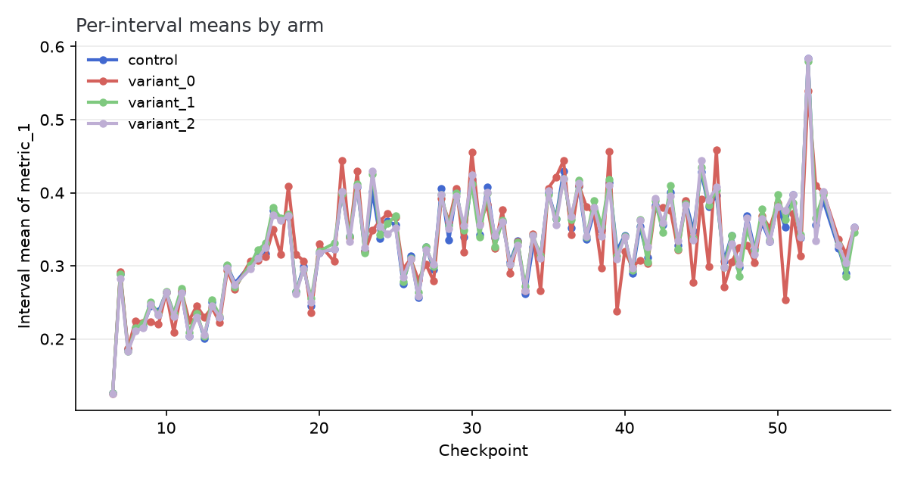
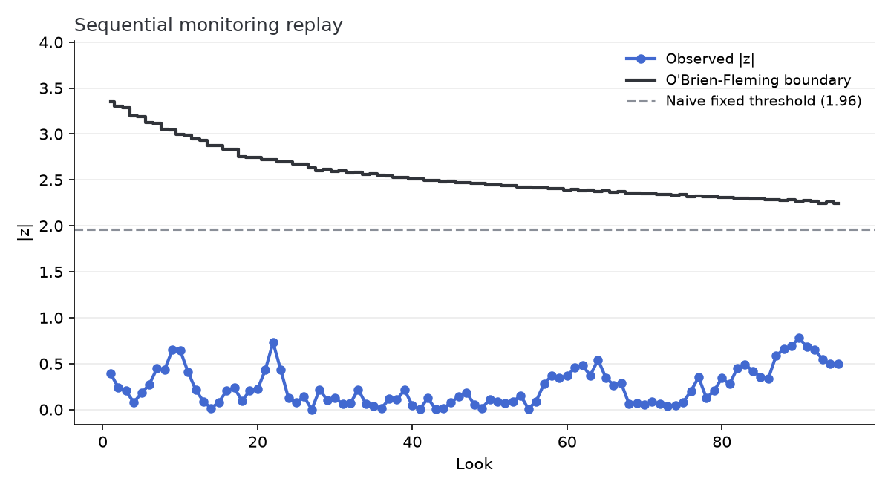
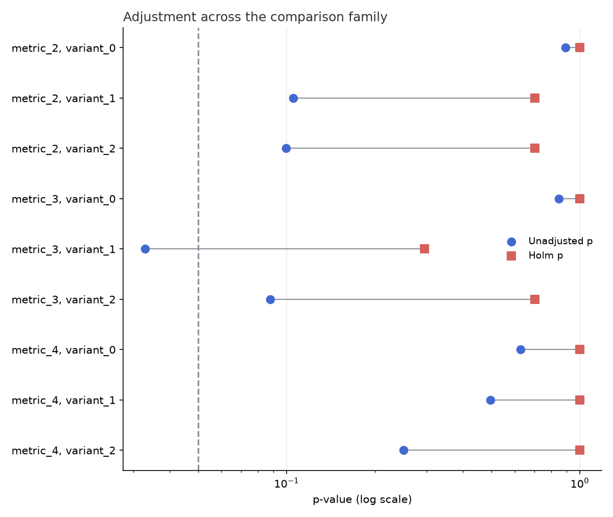

# ASOS experiment 54a85a: analysis

Generated by `python scripts/run_analyze_experiment.py --config analysis/asos/config.toml --sweep` (seed 0) from `asos_digital_experiments_dataset.csv`. Sections appear only where the data can support them. A section you expected but do not see was omitted because its requirements were not met, not overlooked.

The data is the ASOS Digital Experiments Dataset: real online controlled
experiments from ASOS.com, published as daily or twice-daily CUMULATIVE
summary statistics per arm with no user-level rows (Liu, Cardoso,
Couturier, McCoy, NeurIPS 2021, DOI 10.17605/OSF.IO/64JSB, CC BY 4.0).
Provenance and integrity notes are in data/asos/LICENSE-DATA.md. Metrics
are anonymized by the publisher. Its documentation describes metric 1 as
binary, metrics 2 and 3 as count-based, and metric 4 as non-negative
real, with metrics 2 to 4 right-skewed, so numbered names are the only
honest ones available. The single-experiment analysis below reads
experiment 54a85a, chosen by a rule that does not look at this
pipeline's results. The datasheet flags one experiment for a possible
primacy effect (the passage is quoted in LICENSE-DATA.md). The rule
takes that experiment if its variances are complete at every
checkpoint, and otherwise falls back to the complete-variance
experiment with the most checkpoints. 54a85a met both conditions.
Because no user-level rows exist, the resampling analyses do not appear
below. That omission is the report adapting to the data rather than an
oversight.

## 1. Data validation

Arm sizes: control 3,320,536, variant_0 102,316, variant_1 3,316,730, variant_2 3,320,435 (denominators are the primary metric's). The intake altered nothing and dropped nothing. The data passed every validation rule as delivered.

## 2. Sensitivity at this sample size

At the realized sample size (102,316 in the smaller arm of the first contrast) and the control rate of 25.1%, the smallest absolute lift this experiment could detect with 80% power at alpha 0.05 is 0.54 pp (the minimum detectable effect, or MDE). Effects smaller than that could be real and still produce an unremarkable p-value here. That is a property of the sample size, not evidence of absence.

## 3. Assignment validation

The intended allocation for this experiment is not on record, so a direct sample-ratio mismatch (SRM) test against it is impossible. What can be tested without it is RATIO STABILITY. Whichever split was intended, it was presumably constant, so the share of new users landing in each arm should not change across checkpoints. The test below is a chi-square for homogeneity of the per-checkpoint assignment counts (denominators from the primary metric).

| Contrast | Checkpoints | Chi-square | df | p |
|---|---|---|---|---|
| variant_0 vs control | 96 | 78.23 | 95 | 0.894 |
| variant_1 vs control | 96 | 84.26 | 95 | 0.777 |
| variant_2 vs control | 96 | 99.08 | 95 | 0.367 |

The arm ratio is stable across checkpoints in every contrast (alarm threshold p < 1e-3), which is what can still be checked without a declared split.

## 4. Primary metric

The primary metric is **metric_1** (binary). Each treatment arm is compared against control. The test is a pooled two-proportion z-test for binary metrics and a Welch t-test for continuous ones.

| Contrast | Effect | 95% CI | p |
|---|---|---|---|
| variant_0 vs control | -0.07 pp | -0.33 pp to +0.20 pp | 0.635 |
| variant_1 vs control | +0.10 pp | +0.04 pp to +0.17 pp | 0.003 |
| variant_2 vs control | -0.06 pp | -0.12 pp to +0.01 pp | 0.085 |

## 5. Effect stability over time

A treatment effect that fades within the run is the signature of a novelty effect, where users react to the change itself and the reaction decays. The comparison below tests the first 31 checkpoints against the last 31 directly, because two separately-significant windows are not by themselves evidence that the windows differ. Interval values are recovered from the cumulative series by differencing. Figure 1 shows the per-interval means.

| Contrast | Early effect | Late effect | Decay z | p |
|---|---|---|---|---|
| variant_0 vs control | -0.01 pp | -1.26 pp | 2.88 | 0.004 |
| variant_1 vs control | +0.09 pp | +0.08 pp | 0.09 | 0.924 |
| variant_2 vs control | -0.17 pp | +0.23 pp | -3.70 | 0.0002 |

A significant z is evidence that the early and late windows differ, so the end-of-run cumulative number blends two regimes and can sit far from the late-window effect that best describes where the experiment ended up. The z is early minus late. A positive z means the effect moved down over the run, and a negative z means it moved up. Whether that is novelty fading, a harm emerging, or a primacy pattern depends on the effect signs in the table. Either way the late window is the honest number to quote.

One assumption matters for aggregate archives. Differencing cumulative statistics treats each increment as new users only. An archive that recomputes its metrics over all enrolled users at each checkpoint blurs the increments, and this test is approximate there.

The final checkpoint is EXCLUDED from this section. Each increment's variance can be recovered from consecutive cumulative counts, means, and variances. For the first excluded increment that recovery is negative, which no real accumulation of observations can produce. The statistics published there therefore do not describe a superset of the previous checkpoint's sample. A settled recompute or late correction is the usual cause. The exclusion is stated here rather than applied silently.

## 6. What sequential monitoring would have decided

Anyone watching a dashboard peeks. Checking the result at every checkpoint against a fixed |z| > 1.96 threshold (the naive rule) inflates the false-positive rate well beyond the nominal alpha, because every look is another chance to be fooled. An alpha-spending design prices the peeking by allocating the total alpha across the realized look schedule and computing a boundary for each look (O'Brien-Fleming spending, stingy early and generous late). Figure 2 shows the observed |z| path against both rules for the first contrast (variant_0 vs control). A monitoring design guards one pre-declared comparison, and this replay takes the first.

The spending design never crosses in 95 looks, so under monitoring priced for peeking this run does not support stopping early in either direction. The naive rule never fires either. The two agree on this run.

Even a correctly-stopped estimate is biased away from zero at the stopping look. Monitoring is a tool for catching regressions early, not for shipping winners early.

One numerical caveat applies at this look count. The boundaries come from a recursive numerical integration whose grid convergence is pinned by test on a 14-look schedule, so treat the 95-look boundary values as approximate.

As in the effect-stability analysis, the final checkpoint is excluded because the cumulative statistics there are internally inconsistent. The replay covers the 95 consistent looks.

## 7. Multiple comparisons

This experiment carries 9 comparisons beyond the primary metric. Testing each at alpha 0.05 without adjustment gives roughly a 37% chance of at least one false alarm even if nothing moved (treating the comparisons as independent, which shared arms make approximate). The family is therefore adjusted two ways: Holm, which controls the chance of ANY false claim (the right standard for a ship decision), and Benjamini-Hochberg, which controls the false-discovery RATE (the right standard for a screen that feeds follow-ups).

| Metric | Contrast | Effect | Unadjusted p | Holm p | BH q |
|---|---|---|---|---|---|
| metric_2 | variant_0 vs control | +0.001 | 0.893 | 1.000 | 0.893 |
| metric_2 | variant_1 vs control | +0.002 | 0.106 | 0.703 | 0.238 |
| metric_2 | variant_2 vs control | -0.002 | 0.100 | 0.703 | 0.238 |
| metric_3 | variant_0 vs control | -0.003 | 0.848 | 1.000 | 0.893 |
| metric_3 | variant_1 vs control | +0.009 | 0.033 | 0.296 | 0.238 |
| metric_3 | variant_2 vs control | -0.007 | 0.088 | 0.703 | 0.238 |
| metric_4 | variant_0 vs control | -0.185 | 0.628 | 1.000 | 0.808 |
| metric_4 | variant_1 vs control | +0.065 | 0.497 | 1.000 | 0.745 |
| metric_4 | variant_2 vs control | -0.110 | 0.251 | 1.000 | 0.451 |

Unadjusted, 1 comparison clears alpha. After Holm, 0 survive. Figure 3 shows each comparison's p-value before and after adjustment.

## 8. The archive at large: stability and multiplicity

The sections above read one experiment closely. This one asks two mechanical questions of every experiment in the archive (78 total). The first question is assignment stability. With no intended splits on record, the checkable property is that each experiment's arm ratio holds constant across its checkpoints (primary-metric denominators, worst contrast per experiment). 76 experiments were testable. 2 could not be tested (too few usable checkpoints or a degenerate split) and are counted rather than hidden. Experiments flagged at the conventional p < 1e-3 alarm: 6f8a33, 81761c, a4386f.

The second question is multiplicity at scale. Each experiment's full end-of-run comparison family (every metric on every variant) was tested unadjusted and after a per-experiment Holm correction. 41 of 78 experiments show at least one nominally significant comparison before correction. 29 still do after it. The gap between those two counts is the multiple-comparisons trap measured on real experiments rather than argued from theory. (15 comparison cells were skipped because their published statistics were missing or unusable. The skips are counted here.)
