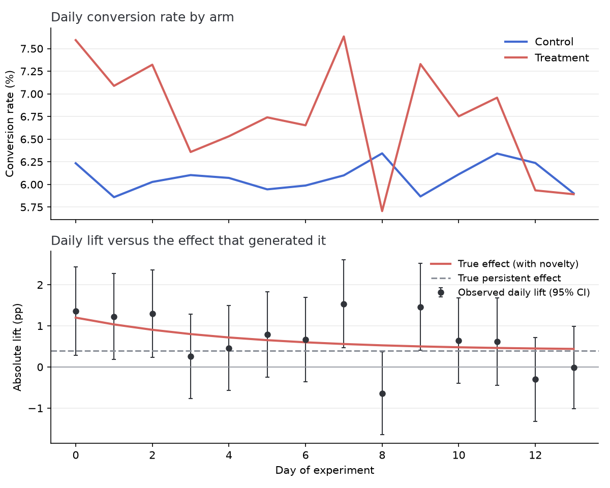
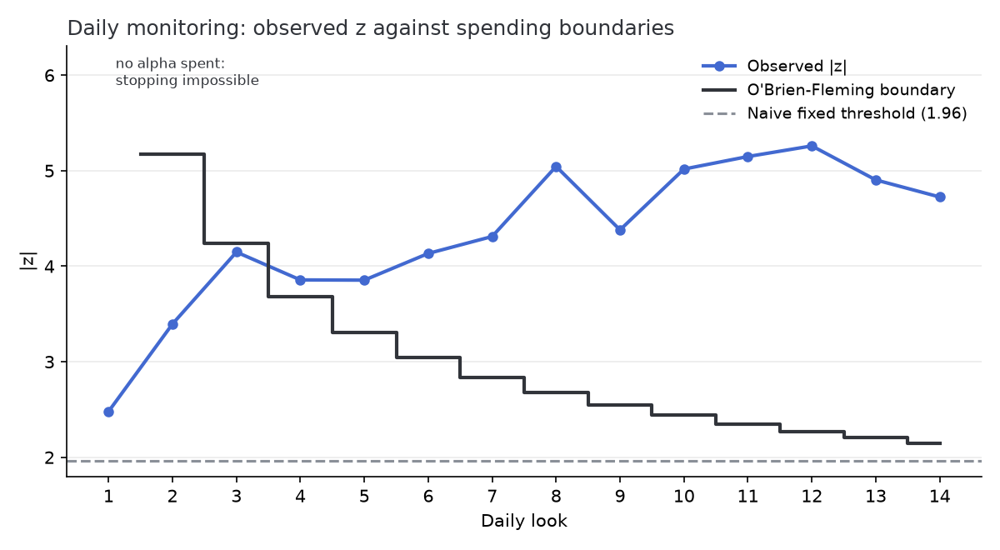
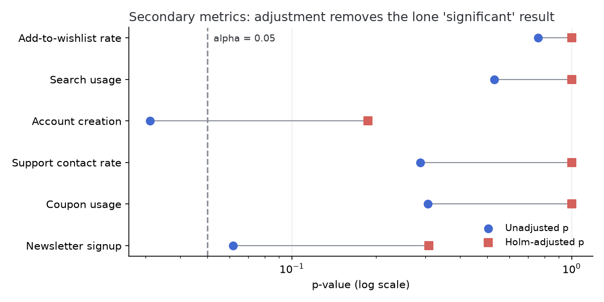
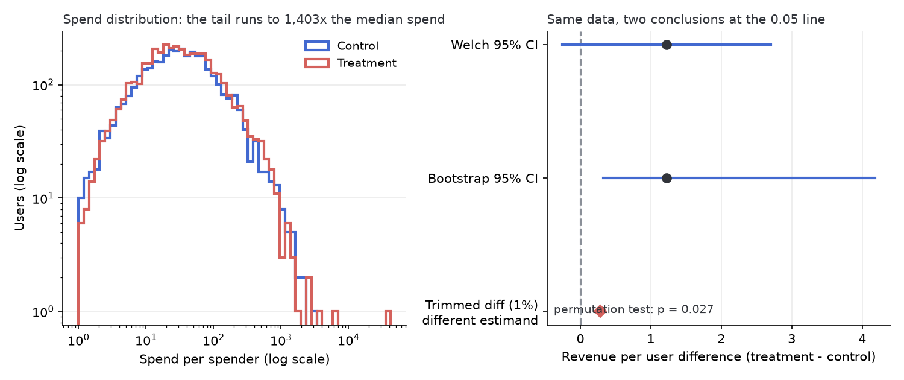

# Checkout redesign: end-to-end experiment analysis

This report walks a synthetic checkout-redesign experiment through the same
pipeline I would use on real data: power the design, validate the assignment,
read the primary metric, check for novelty, replay the monitoring decisions,
correct the secondary metric screen, and work one genuinely ambiguous metric
to a recommendation.

Because the data are synthetic, the true effects are known, and that is the
point. The seeds are fixed, and they were chosen so that each failure mode
this report exists to demonstrate actually shows up in this one run. The
multiple-comparisons section states that plainly for its own starkest case.
At the end I compare what the analysis concluded against what the
generator actually did. Everything here is produced by `scripts/run_build_checkout_report.py`
with fixed seeds. The library functions it calls live in `src/abkit/`, and the
document is rendered by the same engine that renders reports on a user's own
data (`run_analyze_experiment.py`).

## 1. Design and power

The primary metric is checkout conversion, baseline 6.0%. The
smallest effect worth shipping was set at +0.4 percentage points (pp) absolute. For a
two-sided test at alpha 0.05 and 80% power, that needs
**57,057 users per arm** (`sample_size_two_proportions`), so the
experiment was sized at 120,000 users over 14 days with a 50/50
split, giving roughly 60,000 per arm, which leaves some margin over the minimum.

## 2. Assignment validation, and the run we threw away

In this scenario, the first launch of the experiment had a client bug. The treatment redirect
dropped the tracking beacon for a slice of users who bounced without
converting. Nothing about the metric looks wrong on the surface. The
treatment "won" with an observed lift of 0.75 pp. But
the sample-ratio mismatch (SRM) check fails loudly:

| Run | Control n | Treatment n | SRM chi-square | SRM p-value |
|---|---|---|---|---|
| First (bug) | 59,959 | 58,336 | 22.3 | 2.4e-06 |
| Rerun (fixed) | 60,156 | 59,844 | 0.81 | 0.368 |

A 50/50 split does not produce a 49.31%
treatment share at this sample size by chance. Because the missing users were
disproportionately non-converters, the observed treatment rate was biased
upward, and no amount of downstream statistics repairs that. The first run's
data were discarded, the bug was fixed, and everything below analyzes the
rerun, which passes the check.

## 3. Primary metric

| | Control | Treatment |
|---|---|---|
| Users | 60,156 | 59,844 |
| Conversions | 3,658 | 4,039 |
| Rate | 6.08% | 6.75% |

Absolute lift 0.67 pp (95% CI 0.39 pp to
0.95 pp), relative lift 11.0%,
z = 4.72, p = 2.3e-06. This is the full-run
estimate, computed over all 14 days together. It is comfortably
significant. But it is not the number I would ship a forecast on, for the reason in the next section.

## 4. Novelty check

The daily lift drifts downward over the experiment, which is the classic
signature of a novelty effect. Existing users react to the change itself, and
that reaction fades. Figure 1 shows the daily rates and the
daily lift against the effect that generated it.

Splitting the window confirms it:

| Window | Lift | 95% CI | p-value |
|---|---|---|---|
| Days 0-2 | 1.29 pp | 0.68 pp to 1.91 pp | 3.4e-05 |
| Days 10-13 | 0.23 pp | -0.28 pp to 0.75 pp | 0.371 |

Comparing two confidence intervals by eye is not a test of the difference
between them, so I tested the decay directly. The
early-minus-late difference is 1.06 pp (SE 0.41 pp),
z = 2.60, p = 0.009. The fade is real. Reading two intervals
side by side did not create it.

The early days inflate the full-run estimate. The late window is the
best available proxy for the persistent effect. It shows
0.23 pp with a confidence interval wide enough to include
both zero and the +0.4 pp the experiment was powered for. So my
summary is that the treatment very likely helps, that the full-run estimate of
0.67 pp overstates the long-run effect, and that the
14-day window cannot pin the persistent lift precisely. I would report
the late-window interval, not the full-run estimate, and keep a small holdback running
to measure the effect after habituation.

## 5. What daily monitoring would have decided

Everyone peeks. The question is whether the peeking is accounted for. I
replayed the experiment as 14 daily looks two ways: a naive rule that
calls the result at the first |z| > 1.96, and an O'Brien-Fleming alpha-spending
design built on the realized information fractions, each look's share of
the final sample (`abkit.sequential`).

Using realized rather than planned fractions is what the spending-function
approach is for, and it does not cost anything here. The look *schedule* was
fixed in advance at one look per day, and the realized fractions differ from
an even 14-way split by at most 0.0015. What would void the
guarantee is choosing the looks after seeing the data, which is a different
thing entirely. Figure 2 shows both rules against the observed
z path.

The naive rule would have stopped at **look 1**, when the novelty
effect was near its peak, locking in a cumulative lift of
1.36 pp, about 3.4x the true persistent effect.
The spending design first crosses at **look 4**,
spending almost no alpha in the noisy early days. In fact it spends so little
that the first look has no finite boundary at all. The alpha allocated
there sits below the library's 1e-10 spending floor, so the look is treated
as unspendable and no day-1 z-statistic can stop the experiment,
which is why the boundary line in the figure starts at look
2.
Under a true null on this exact look schedule, simulation (100,000 runs)
puts the naive rule's false-positive rate at 21.9% against the
nominal 5%; the spending design holds 4.9%.

Early stopping is a tool for catching harmful changes quickly, not for
launching apparent improvements early. Even the correctly stopped estimate is biased away from zero
by the stopping rule itself, and here it is also biased upward by the
novelty effect at that point in the run.

## 6. Secondary metrics and multiple comparisons

Six secondary metrics were tracked. None of them was actually moved by
the treatment (the generator applied zero lift to all six), which makes
this a live-fire test of the correction machinery.

| Metric | Observed lift | Unadjusted p | Holm p | BH q |
|---|---|---|---|---|
| Add-to-wishlist rate | 0.07 pp | 0.758 | 1.000 | 0.758 |
| Search usage | -0.14 pp | 0.529 | 1.000 | 0.635 |
| Account creation | -0.50 pp | 0.031 | 0.187 | 0.185 |
| Support contact rate | -0.25 pp | 0.288 | 1.000 | 0.461 |
| Coupon usage | 0.23 pp | 0.307 | 1.000 | 0.461 |
| Newsletter signup | 0.43 pp | 0.062 | 0.309 | 0.185 |

Read naively, **Account creation** clears the line at
p = 0.031. Note the direction. The observed lift is
-0.50 pp, so the naive reading is a drop, not the improvement a
scan of the p-value column alone would suggest. That is the trap twice over.
With six true nulls the chance of at least one unadjusted p below 0.05 is
26%, so one flagged metric is unremarkable rather than a
discovery. Both corrections push every metric back above the line. Holm
controls the family-wise error rate, the chance of even one false positive,
which is the right standard for a ship decision. Benjamini-Hochberg (BH) controls
the false discovery rate (FDR), the expected share of flagged metrics that
are false, which is the right standard for a screening pass.

The seed here was chosen to land on a run that exhibits the false positive.
Under six independent true nulls only about 23% of runs would produce exactly
one nominally significant metric, and most would produce none. The run was picked deliberately to show
the machinery working, and a report about not reading luck as signal should
say so rather than present the draw as typical.
Figure 3 shows the adjustment pulling the flagged metric
back across the line.

## 7. Revenue per user: the ambiguous one

Revenue per user is the metric leadership actually asks about, and it is the
one this experiment cannot answer cleanly. The distribution is zero-inflated
(94% of users spend nothing) with a Pareto tail. The generator
gives roughly 1 in 125 spenders a "whale" draw whose distribution has
infinite variance. The generator was built this way on purpose, so the
analysis has to face the heavy tail a revenue metric carries. Figure 4 shows the distributions and the interval
disagreement.

| Method | Estimate | Interval / p |
|---|---|---|
| Welch t-test | +1.23 per user | 95% CI -0.25 to +2.71, p = 0.104 |
| BCa bootstrap | +1.23 per user | 95% CI +0.32 to +4.18 |
| Permutation test | +1.23 per user | p = 0.027 |
| Trimmed mean diff (1%) | +0.29 per user | different estimand, see below |

The first three estimate the same quantity and disagree about it. One caveat
applies before the bootstrap is used as a tiebreaker. Its coverage
evidence in this repo is finite-variance only, and under an infinite-variance
tail the bootstrap interval for a mean is itself unstable, which is part of
the point. The Welch
test says not significant (p = 0.104). The permutation test says
significant (p = 0.027). The bootstrap interval
(+0.32 to +4.18) excludes zero, but its lower bound barely
clears it.

The Welch/permutation split has a specific cause. The permutation test is
exact in principle under the sharp null that the two arms
have *identical distributions*, and the treatment here does change the
distribution, because it raises the probability of spending at all. So the permutation
test can correctly reject while the *mean* difference, which is what Welch is
estimating, stays badly determined by a few large draws. The two tests ask
two different questions, and only one of them is the one leadership asked.

The trimmed difference is a diagnostic, not a fourth estimate of the same
thing, and the table above would be misleading if it were read as one. With
94% of users at zero, trimming 1% from each tail of each arm cuts, in
the control arm alone, 601 zeros off the bottom and about 17% of the *spenders* off
the top. It therefore targets a different population quantity. The control
arm's own mean falls from 4.47 to 1.56 with no treatment
effect involved at all. The useful signal is that +0.29 and
+1.23 are far apart, which says the raw difference rests on the
part of the distribution the trim removes. But any heavy right tail produces
that gap, so it points at fragility rather than proving whales specifically.

There is no analysis trick that resolves this, because the ambiguity is real.
The true effect the generator planted is +0.32 per user, and
with this tail the experiment only had roughly
7% power to detect it. That figure uses the realized sample
standard deviation of 130, itself an unstable estimate under an
infinite-variance tail. The generator draws whale amounts from the same distribution in both
arms, so which arm the largest whales landed in is sampling noise *by
construction*. A method that reads that imbalance as effect is reading noise,
and we know it is noise because we built the data.

My read is that the revenue evidence is directionally positive and consistent
with the conversion result, that the point estimate rests on draws that contain no
signal, and that I would not quote a revenue impact number from this
experiment. If a
revenue claim matters, the follow-up should use a metric that a single whale
cannot move (capped revenue or spender conversion), declared in advance and
sized for it.

What I would not do is run all four and report the one that crossed 0.05. They
were all planned. The disagreement itself is the finding, and it says
"underpowered for this metric," not "significant if you pick the right test."

## 8. What the generator actually did

| Quantity | Truth | Full-run estimate | Best estimate |
|---|---|---|---|
| Persistent conversion lift | 0.4 pp | 0.67 pp | 0.23 pp (days 10-13, CI -0.28 pp to 0.75 pp) |
| Day-0 novelty boost | 0.8 pp | not separately reported | decay visible in the daily-lift panel in section 4 |
| Secondary metric lifts | 0 on all six | one naive false positive | none significant after Holm |
| Revenue per user diff | +0.32 | +1.23 | Welch interval spanning zero; underpowered |

The pipeline got the qualitative story right everywhere. It caught the broken
first run, flagged the novelty inflation instead of shipping the full-run
estimate, and refused the spurious secondary result. On the underpowered revenue
metric, it declined to quote an impact number at all. The place it cannot
help is where the data simply do not contain the answer. The persistent
lift and the revenue effect both need more time or a better metric, and the
report says so rather than manufacturing certainty.

### Recommendation

Ship the redesign on the strength of the conversion result, quote the
late-window interval rather than the full-run estimate, keep a holdback running for four
more weeks to measure the post-novelty effect, and define a capped revenue
metric before the follow-up starts.
