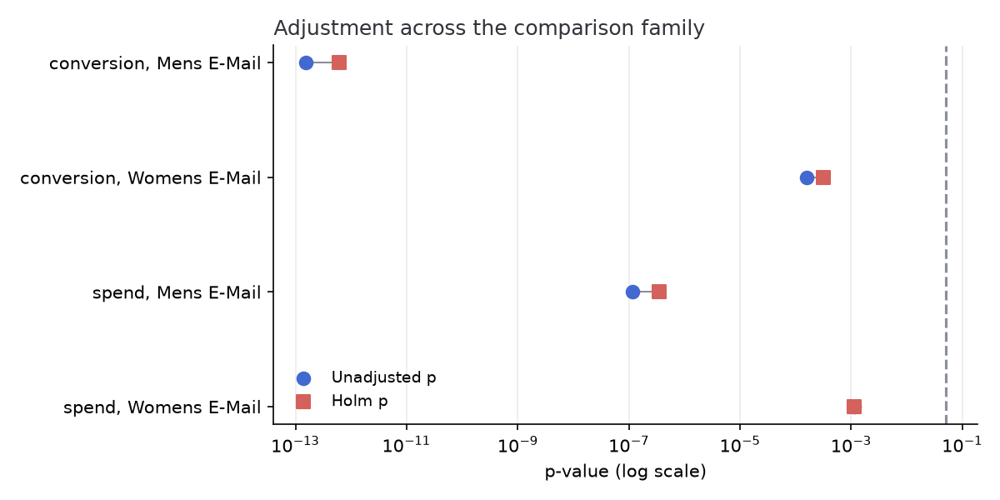
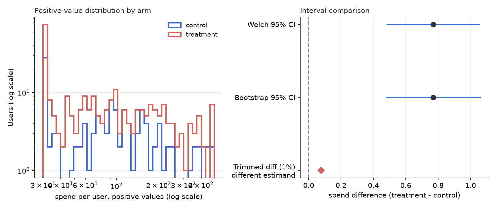

# Hillstrom e-mail experiment: experiment analysis

Generated by `scripts/run_analyze_experiment.py --config config.toml` (seed 0) from `hillstrom.csv`. Sections appear only where the data can support them; a section you expected but do not see was omitted because its requirements were not met, not overlooked.

The data is Kevin Hillstrom's MineThatData E-Mail Analytics And Data
Mining Challenge (2008): 64,000 customers of a retailer randomly
assigned in thirds to a men's merchandise e-mail, a women's merchandise
e-mail, or no e-mail, with site visits, conversion, and dollars spent
tracked for the following two weeks. It is real, user-level, and the
standard public benchmark for incremental-lift analysis. The publisher
never stated a license, so the file is fetched from its original URL by
scripts/run_fetch_hillstrom.py (SHA-256 pinned there) rather than
redistributed in this repository. The data carries no per-day fields,
so the time-based sections do not appear below; that omission is the
report adapting to the data. It does carry a genuine data wart, the
misspelled category value the validation section records normalizing,
which is exactly the kind of cleaning a real intake has to own out
loud.

## 1. Data validation

Arm sizes after validation: No E-Mail 21,306, Mens E-Mail 21,307, Womens E-Mail 21,387 (denominators are the primary metric's). Every change the intake made or refused is listed here, because silently cleaned data is how an analysis stops being about the experiment that actually ran.

| Rule | Rows | Where |
|---|---|---|
| alias_normalized | 28776 | first at data row 2 |

## 2. Sensitivity at this sample size

At the realized sample size (21,306 in the smaller arm of the first contrast) and the control rate of 10.6%, the smallest absolute lift this experiment could detect with 80% power at alpha 0.05 is 0.85 pp (the minimum detectable effect, or MDE). Effects smaller than that could be real and still produce an unremarkable p-value here; that is a property of the sample size, not evidence of absence.

## 3. Assignment validation

A sample-ratio mismatch check (SRM) asks whether the number of users who actually landed in each arm matches the intended split; a failure means the assignment or logging lost users asymmetrically, which biases every metric in ways no downstream statistic can fix.

| Contrast | Control n | Treatment n | Chi-square | p |
|---|---|---|---|---|
| Mens E-Mail vs No E-Mail | 21,306 | 21,307 | 0.00 | 0.971 |
| Womens E-Mail vs No E-Mail | 21,306 | 21,387 | 0.18 | 0.672 |

No contrast fails the check (conventional alarm threshold p < 1e-3), so the realized split is consistent with the declared one.

## 4. Primary metric

The primary metric is **visit** (binary). Each treatment arm is compared against control; the test is a pooled two-proportion z-test for binary metrics and a Welch t-test for continuous ones.

| Contrast | Effect | 95% CI | p |
|---|---|---|---|
| Mens E-Mail vs No E-Mail | 7.66 pp | 6.99 pp to 8.32 pp | 5.7e-112 |
| Womens E-Mail vs No E-Mail | 4.52 pp | 3.89 pp to 5.16 pp | 3.2e-44 |

## 5. Multiple comparisons

This experiment carries 4 non-primary comparisons. Testing each at alpha 0.05 without adjustment gives a 19% chance of at least one false alarm even if nothing moved, so the family is adjusted two ways: Holm, which controls the chance of ANY false claim (the right standard for a ship decision), and Benjamini-Hochberg, which controls the false-discovery RATE (the right standard for a screen that feeds follow-ups).

| Metric | Contrast | Effect | Unadjusted p | Holm p | BH q |
|---|---|---|---|---|---|
| conversion | Mens E-Mail vs No E-Mail | 0.68 pp | 1.5e-13 | 6.1e-13 | 6.1e-13 |
| conversion | Womens E-Mail vs No E-Mail | 0.31 pp | 0.0002 | 0.0003 | 0.0002 |
| spend | Mens E-Mail vs No E-Mail | +0.770 | 1.2e-07 | 3.5e-07 | 2.3e-07 |
| spend | Womens E-Mail vs No E-Mail | +0.424 | 0.001 | 0.001 | 0.001 |

Unadjusted, 4 comparison(s) clear alpha; after Holm, 4 survive. Figure 1 shows each comparison's p-value before and after adjustment.

## 6. Heavy-tailed metric: spend

**spend** is the kind of metric where a few extreme users can carry the average (99% of users sit at zero here), so it gets four looks that stress the tail differently: a Welch t-test (relies on the normal approximation of the mean), a percentile bootstrap (resamples the observed tail), a permutation test (exact under the null that the arms' distributions are identical), and a trimmed-mean difference (a diagnostic for tail dependence, deliberately a different estimand).

| Method | Estimate | Interval / p |
|---|---|---|
| Welch t-test | +0.770 | 95% CI +0.485 to +1.055, p = 1.2e-07 |
| Percentile bootstrap | +0.770 | 95% CI +0.482 to +1.059 |
| Permutation test | +0.770 | p = 1.0e-04 |
| Trimmed mean diff (1%) | +0.078 | different estimand |

Figure 2 shows the distributions and the interval comparison for the first contrast (Mens E-Mail vs No E-Mail). The three same-estimand methods agree here, which is what a well-behaved tail looks like.

