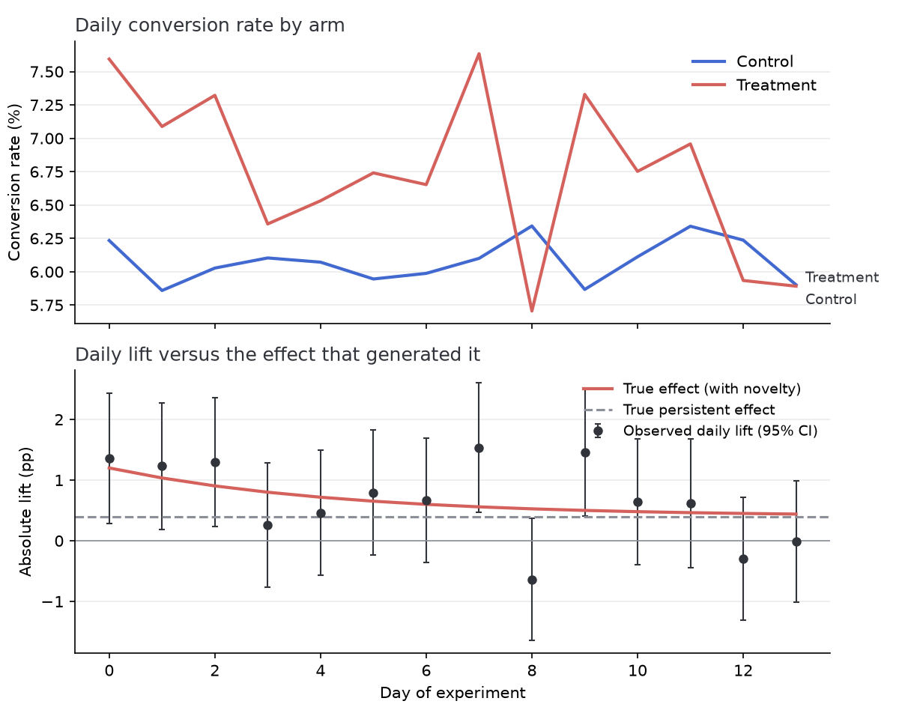
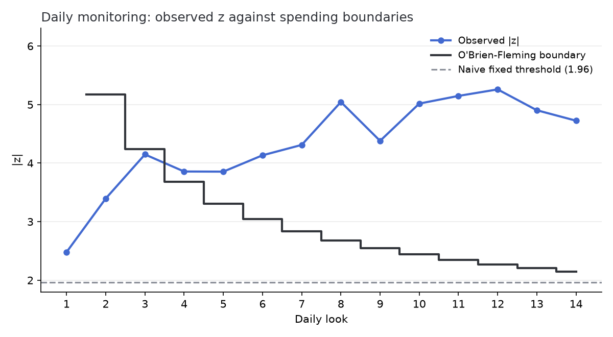
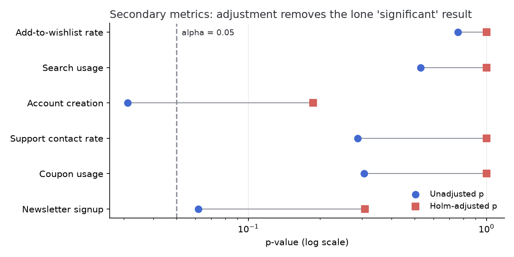
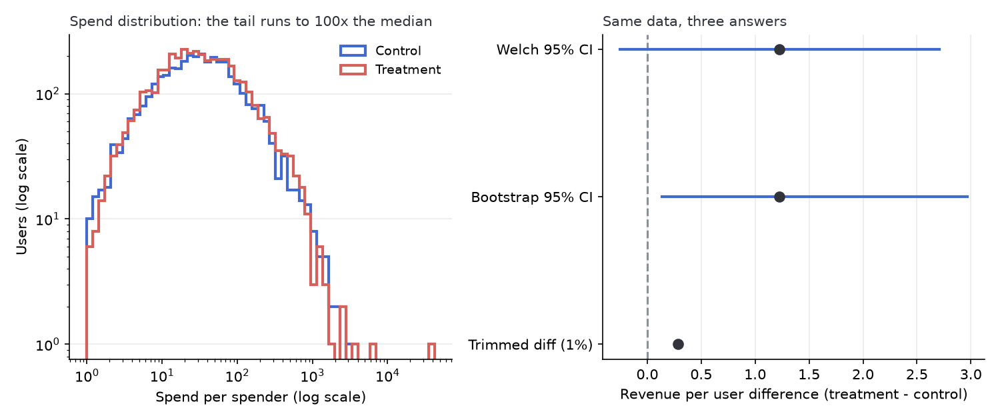

# Checkout redesign: end-to-end experiment analysis

This report walks a synthetic checkout-redesign experiment through the same
pipeline I would use on real data: power the design, validate the assignment,
read the primary metric, check for novelty, replay the monitoring decisions,
correct the secondary metric screen, and work one genuinely ambiguous metric
to a recommendation.

Because the data are synthetic, the true effects are known, which is the
point: at the end I compare what the analysis concluded against what the
generator actually did. Everything here is produced by `run_analysis.py`
with fixed seeds; the library functions it calls live in `src/abkit/`.

## 1. Design and power

The primary metric is checkout conversion, baseline 6.0%. The
smallest effect worth shipping was set at +0.4 pp absolute. For a
two-sided test at alpha 0.05 and 80% power, that needs
**57,057 users per arm** (`sample_size_two_proportions`), so the
experiment was sized at 120,000 users over 14 days with a 50/50
split, giving roughly 60,000 per arm - some margin over the minimum.

## 2. Assignment validation, and the run we threw away

The first launch of this experiment had a client bug: the treatment redirect
dropped the tracking beacon for a slice of users who bounced without
converting. Nothing about the metric looks wrong on the surface - the
treatment "won" with an observed lift of 0.75 pp - but
the sample-ratio check fails loudly:

| Run | Control n | Treatment n | SRM chi-square | SRM p-value |
|---|---|---|---|---|
| First (bug) | 59,959 | 58,336 | 22.3 | 2.4e-06 |
| Rerun (fixed) | 60,156 | 59,844 | 0.81 | 0.368 |

A 50/50 split does not produce a 49.31%
treatment share at this sample size by chance. Because the missing users were
disproportionately non-converters, the observed treatment rate was biased
upward, and no amount of downstream statistics repairs that. The first run's
data were discarded, the bug was fixed, and everything below analyzes the
rerun, which passes the check.

## 3. Primary metric

| | Control | Treatment |
|---|---|---|
| Users | 60,156 | 59,844 |
| Conversions | 3,658 | 4,039 |
| Rate | 6.08% | 6.75% |

Absolute lift 0.67 pp (95% CI 0.39 pp to
0.95 pp), relative lift 11.0%,
z = 4.72, p = 2.3e-06. The headline result
is comfortably significant. But the headline is not the number I would ship a
forecast on, for the reason in the next section.

## 4. Novelty check

The daily lift drifts downward over the experiment, which is the classic
signature of a novelty effect: existing users react to the change itself, and
that reaction fades.

Splitting the window confirms it:

| Window | Lift | 95% CI | p-value |
|---|---|---|---|
| Days 0-2 | 1.29 pp | 0.68 pp to 1.90 pp | 3.4e-05 |
| Days 10-13 | 0.23 pp | -0.28 pp to 0.75 pp | 0.371 |

The early window carries most of the headline effect. The late window - the
best available proxy for the persistent effect - shows
0.23 pp with a confidence interval wide enough to include
both zero and the +0.4 pp the experiment was powered for. So the
honest summary is: the treatment very likely helps, the headline
0.67 pp overstates the long-run effect, and the
14-day window cannot pin the persistent lift precisely. I would report
the late-window interval, not the headline, and keep a small holdback running
to measure the effect after habituation.

## 5. What daily monitoring would have decided

Everyone peeks. The question is whether the peeking is accounted for. I
replayed the experiment as 14 daily looks two ways: a naive rule that
calls the result at the first |z| > 1.96, and an O'Brien-Fleming alpha-spending
design built on the realized information fractions (`abkit.sequential`).

The naive rule would have stopped at **look 1**, when the novelty
effect was near its peak, locking in a cumulative lift of
1.36 pp - about 3x the persistent effect.
The spending design first crosses at **look 4**,
spending almost no alpha in the noisy early days. Under a true null on this
exact look schedule, simulation (100,000 runs) puts the naive rule's
false-positive rate at 21.9% against the nominal 5%; the
spending design holds 4.9%.

Early stopping is a tool for catching regressions quickly, not for shipping
winners early: even the correctly-stopped estimate is biased upward by the
novelty effect at that point in the run.

## 6. Secondary metrics and multiple comparisons

Six secondary metrics were tracked. None of them was actually moved by the
treatment (the generator applied zero lift to all six), which makes this a
live-fire test of the correction machinery.

| Metric | Observed lift | Unadjusted p | Holm p | BH q |
|---|---|---|---|---|
| Add-to-wishlist rate | 0.07 pp | 0.758 | 1.000 | 0.758 |
| Search usage | -0.14 pp | 0.529 | 1.000 | 0.635 |
| Account creation | -0.50 pp | 0.031 | 0.187 | 0.185 |
| Support contact rate | -0.25 pp | 0.288 | 1.000 | 0.461 |
| Coupon usage | 0.23 pp | 0.307 | 1.000 | 0.461 |
| Newsletter signup | 0.43 pp | 0.062 | 0.309 | 0.185 |

Read naively, **Account creation** looks like a significant win at
p = 0.031. That is exactly the trap: with six true nulls,
the chance of at least one unadjusted p below 0.05 is about 26%. Both the
Holm adjustment (family-wise control, the right tool for a ship decision) and
Benjamini-Hochberg (FDR control, the right tool for a screening pass) push
every metric back above the line.

## 7. Revenue per user: the ambiguous one

Revenue per user is the metric leadership actually asks about, and it is the
one this experiment cannot answer cleanly. The distribution is zero-inflated
(about 6% of users spend anything) with a Pareto tail: the
generator gives roughly 1 in 125 spenders a "whale" draw whose distribution
has infinite variance. This is not an exotic choice; real revenue data looks
like this.

| Method | Estimate | Interval / p |
|---|---|---|
| Welch t-test | +1.23 per user | 95% CI -0.25 to +2.71, p = 0.104 |
| Percentile bootstrap | +1.23 per user | 95% CI +0.14 to +2.97 |
| Permutation test | +1.23 per user | p = 0.029 |
| Trimmed mean diff (1%) | +0.29 per user | - |

The methods genuinely disagree. The Welch test says not significant
(p = 0.104); the permutation test says significant
(p = 0.029); the bootstrap interval
(+0.14 to +2.97) excludes zero, but its lower
bound is a whisker above it. The trimmed estimate, which discards the top and bottom 1% of each
arm, is far below the raw difference of +1.23 - the raw
estimate is carried substantially by a handful of whales that happened to
land in the treatment arm.

There is no analysis trick that resolves this, because the ambiguity is real:
the true effect the generator planted is +0.32 per user, and
with this tail the experiment only had roughly
6% power to detect it (using the realized sample
standard deviation of 130, itself an unstable estimate under an
infinite-variance tail). My read: the revenue evidence is directionally
positive and consistent with the conversion result, the point estimate is
inflated by whales, and I would not quote a revenue impact number from this
experiment. If a revenue claim matters, the follow-up should use a
whale-robust metric (capped revenue or spender conversion) declared in
advance, sized for it.

What I would not do is run all four tests and report the one that crossed
0.05. The tests were all planned; the disagreement itself is the finding, and
it says "underpowered for this metric," not "significant if you pick the
right test."

## 8. What the generator actually did

| Quantity | Truth | Headline estimate | Best estimate |
|---|---|---|---|
| Persistent conversion lift | 0.4 pp | 0.67 pp | 0.23 pp (days 10-13, CI -0.28 pp to 0.75 pp) |
| Day-0 novelty boost | 0.8 pp | not separately reported | visible in figure 1 decay |
| Secondary metric lifts | 0 on all six | one naive false positive | none significant after Holm |
| Revenue per user diff | +0.32 | +1.23 | interval spanning zero; underpowered |

The pipeline got the qualitative story right everywhere: it caught the broken
first run, flagged the novelty inflation instead of shipping the headline
number, refused the spurious secondary win, and declined to over-read an
underpowered revenue metric. The place it cannot help is where the data
simply do not contain the answer - the persistent lift and the revenue effect
both need more time or a better metric, and the report says so rather than
manufacturing certainty.

## Recommendation

Ship the redesign on the strength of the conversion result, quote the
late-window interval rather than the headline, keep a 5% holdback for four
more weeks to measure the post-novelty effect, and define a capped revenue
metric before the follow-up starts.
